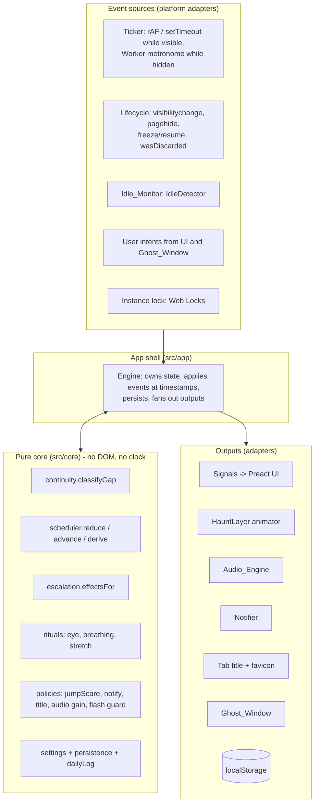

# Design Document: Spooky Break Reminder

## Overview

Spooky Break Reminder is a static single-page web app (Vite + TypeScript, deployed to GitHub Pages at `/spooky-break-reminder/`) that turns an ignored break into a progressive "possession" of the screen and ends it only through a real break activity (an exorcism Ritual) or a real absence. All data stays in `localStorage`.

The design has one rule that drives everything else: **the schedule is a pure, time-driven state machine, and every browser API is a thin adapter around it.** The core never reads `Date.now()`, never touches the DOM and never schedules timers. It receives events with explicit durations and returns a new state. This gives three benefits:

1. Background throttling, tab freezing, reloads and Demo_Mode all reduce to "how much schedule time passed", so they cannot corrupt the schedule.
2. The core is the target of the fast-check property tests (Requirement 29), which is also the main "Tech" story for the judges.
3. The same core drives the Main_Screen, the Ghost_Window, the tab title, the favicon, notifications and audio, so they cannot disagree.

### Key Decisions

| Topic | Decision | Main alternative considered | Reason |
|---|---|---|---|
| UI framework | Preact + `@preact/signals` for screens, forms and Rituals | Vanilla DOM; React; Svelte | Small bundle (about 6 KB gzip), JSX speeds up a two-week build, signals make the language switch (20.3) and multi-surface updates trivial. Preact attaches listeners directly to elements, so components also work inside the Ghost_Window document. |
| Effects rendering | Framework-free `HauntLayer`: stacked DOM/SVG layers whose CSS custom properties are driven by a small `requestAnimationFrame` animator; only `opacity` and `transform` animate | WebGL fog shader; Canvas 2D particles; animated SVG `feTurbulence` | Compositor-only animation stays cheap in an all-day office tab, works unchanged in the Ghost_Window, maps directly onto Reduced_Motion, and its parameters come from a pure function that we can test. WebGL adds context-loss handling, a second GL context for the Ghost_Window and battery cost. Animated `feTurbulence` repaints the full screen every frame. |
| Fog texture | Generated once at startup from seeded value noise on an offscreen canvas, stored as an object URL | Authored image files | No asset pipeline, deterministic, same origin (21.8). An authored WebP is the fallback if generation turns out slow. |
| Audio | Web Audio synthesis (filtered-noise whispers, sine chimes and cue tones, a synthesized scream) | Recorded files | Team-created by construction (31.8), no licensing work, tiny download. The meaning of a Whisper is carried by its caption (4.13), so the audio can stay language-neutral. |
| Time base | Integer milliseconds; schedule time = wall-clock delta x speed (1 or 60); negative deltas clamp to 0 | Anchor timestamps (`dueAt`) | Accumulators make pauses, Demo_Mode and gap handling explicit, and make `advance` additive, which is a strong, simple property to test. |
| Hidden-tab wake-ups | A dedicated Worker "metronome" posts a message every 10 s while the document is hidden; main-thread timers are a backup | Main-thread timers only | Chrome's intensive throttling limits hidden-page chained timers to one wake-up per minute ([Chrome blog](https://developer.chrome.com/blog/timer-throttling-in-chrome-88)). Worker messages keep Due_Time detection, title updates and the 30-second persistence heartbeat inside the bounds of 1.8, 14.1 and 16.6. |
| Single active tab | Web Locks API (`navigator.locks`) with `ifAvailable` and `steal`; `storage` events for state refresh | BroadcastChannel leader election | Web Locks is Baseline since 2022, releases the lock automatically when a tab closes and supports take-over directly ([MDN](https://developer.mozilla.org/en-US/docs/Web/API/Web_Locks_API)). |
| Validation | Hand-written validators generated from one `SETTINGS_SPEC` table | zod / valibot | No dependency, and the same table drives the Settings_Panel ranges (21.1, 21.2). |
| Demo_Mode | Chosen per page load from `?demo=1`; separate storage namespace and separate lock name | In-place mode switch | Keeps demo data apart from normal use (25.7) with no teardown logic. The Settings toggle navigates to the URL with or without `demo=1`. |

### Browser Facts That Shape the Design

These facts were checked on 2026-11-20. Content was rephrased for compliance with licensing restrictions.

| Fact | Source | Consequence |
|---|---|---|
| The `freeze` / `resume` events and `document.wasDiscarded` exist only in Chromium; Firefox and Safari do not implement them. A discard from the hidden or frozen state fires no event at all. | [Chrome Page Lifecycle API](https://developer.chrome.com/docs/web-platform/page-lifecycle-api), [Stack Overflow summary of support](https://stackoverflow.com/questions/77529969/detect-if-browser-supports-freeze-and-resume-lifecycle-events) | Browser interventions can be positively identified only in Chrome and Edge. See "Schedule Continuity" below. |
| No web API reports that the device slept. `performance.now()` should keep counting during sleep per the HR-Time spec, but only Chromium and Firefox on Windows do; on macOS and Linux it pauses during sleep. | [MDN content issue #33760](https://github.com/mdn/content/issues/33760), [WHATWG HTML issue #6759](https://github.com/whatwg/html/issues/6759) | A wall-clock delta that exceeds the monotonic delta is evidence of a suspend, but only on some platforms. It is used as extra evidence, never as the only signal. |
| Chrome throttles hidden pages: after 5 minutes hidden and 30 seconds silent, chained timers wake at most once per minute. Pages that play audio are exempt. | [Chrome blog](https://developer.chrome.com/blog/timer-throttling-in-chrome-88) | Timestamp-based accounting plus the Worker metronome. |
| Since Chrome 133, CPU-intensive background tabs can be frozen while Energy Saver is on. Memory Saver can discard inactive tabs. | [Chrome blog](https://developer.chrome.com/blog/freezing-on-energy-saver) | The app must stay light in the background, and freeze/discard handling is needed. The README tells Chrome users how to keep the site active. |
| Document Picture-in-Picture is available in Chrome and Edge 116+ and, since May 2026, in desktop Firefox 151+. Safari does not support it. | [Firefox 151 release notes](https://developer.mozilla.org/en-US/docs/Mozilla/Firefox/Releases/151), [MDN](https://developer.mozilla.org/en-US/docs/Web/API/Document_Picture-in-Picture_API) | The Ghost_Window works in three of the four target browsers. 17.7 names them (applied from "Requirement Wording Adjustments"). |
| The Idle Detection API is Chromium-only, permission-gated, and its `threshold` has a minimum of 60 000 ms. | [MDN IdleDetector.start()](https://developer.mozilla.org/en-US/docs/Web/API/IdleDetector/start) | Matches 13.3. The idle start is back-dated by the threshold. |
| Safari ignores most favicon changes made from JavaScript. | [Stack Overflow](https://stackoverflow.com/questions/79637210/different-light-and-dark-mode-favicons-in-safari/79659011) | 16.3 and 16.4 apply only where the browser applies favicon changes made by the page, so Safari keeps the static favicon while the title still updates. Listed under Known Limitations in `requirements.md` and in the README browser support table (30.5). |

## Architecture



### Runtime Loop

Every input becomes `engine.dispatch(event, atWall)`:

1. **Measure.** `dtWall = atWall - lastAliveWall`. If `dtWall` exceeds the Gap_Tolerance (45 s), the gap was not observed, and `continuity.classifyGap` decides how to account for it.
2. **Advance.** The engine calls `scheduler.advance(state, scheduleDelta)`, where `scheduleDelta = max(0, dtWall) x speed`. `advance` splits time at every boundary (Due_Time, Snooze end, Pause end) internally.
3. **Apply.** The engine applies the event itself (`snooze`, `ritualStarted`, `awayEnded`, ...) with `scheduler.reduce`.
4. **Commit.** It persists the state when the phase changed or 30 s have passed, then derives the `ScheduleView` and pushes it to the signals, the HauntLayer, the Audio_Engine, the Notifier, the tab title, the favicon and the Ghost_Window. Output policies compare the previous view with the next view, so a catch-up after a long gap produces one coherent update instead of a burst of stale notifications.

Events that happened in the past are applied at their own timestamps. For example, when a hidden Ritual times out after 60 s (7.8) and the user returns later, the engine advances to `hiddenAt + 60 s` with no overdue accrual, applies `ritualEnded`, then advances to now with accrual.

### Wake-up Cadence

| Document state | Wake-up source | Cadence | Bound it serves |
|---|---|---|---|
| Visible | `setTimeout` to the next interesting instant (next displayed second, Due_Time, level boundary, Snooze end, Pause end), clamped to 16..1000 ms; `requestAnimationFrame` only while the animator has work | at most 1 s | 1.7, 16.6 visible |
| Hidden | Worker metronome message | 10 s | 1.8, 14.1, 16.6 hidden |
| Any | `visibilitychange`, `pageshow`, `resume`, `focus`, idle change, notification click | immediate | catch-up on return |

The hidden-document bounds of 1.8 and 16.6 apply in Chrome, Edge and Firefox. Safari publishes no wake-up guarantee for hidden pages, so in Safari the bounds are best-effort and the App re-evaluates the schedule as soon as the App document becomes visible (Known Limitations in `requirements.md`).

No `requestAnimationFrame` runs while the App document is hidden (19.10), and CSS animations pause through a `data-hidden` attribute on the root element.

### Source Layout

```
.github/workflows/deploy.yml
.kiro/specs/spooky-break-reminder/{requirements,design,tasks}.md
.kiro/steering/{product,tech,structure}.md
.kiro/hooks/{run-tests-on-save,i18n-parity-on-save,kiro-guard-on-gitignore-save}.json
docs/{demo-script.md, submission-checklist.md, screenshots/}
public/icons/{candle,level-1,...,level-5}.svg, public/fonts/<display-font>.woff2 + OFL.txt
scripts/{kiro-guard.mjs, check-i18n.mjs, verify-deploy.mjs}
src/core/        time, scheduler, escalation, continuity, rituals/, jumpScare, flashGuard,
                 notifyPolicy, tabStatus, audioPolicy, settings, persistence, dailyLog, rng
src/platform/    clock, ticker, metronome.worker, storage, lifecycle, idle, notifier,
                 audio/, pip, tab, instanceLock, media
src/effects/     hauntLayer, animator, fogTexture, cracks, ghostArt
src/ui/          MainScreen, Candle, HauntControls, PauseMenu, DailyLog, rituals/,
                 Settings, Onboarding, Notices, NightmareWarning, JumpScare, GhostPanel, LiveRegion
src/i18n/        index.ts, locales/en.json, locales/zh-CN.json
src/app/         engine.ts, store.ts, main.tsx
tests/           *.test.ts (examples), *.prop.test.ts (fast-check)
index.html, vite.config.ts, tsconfig.json, package.json, LICENSE, README.md, .gitignore
```

`src/core` must not import from `src/platform`, `src/ui` or `src/effects`. The tech steering document states this rule, and an ESLint `no-restricted-imports` rule (or a simple Vitest check that scans the imports) enforces it.

## Components and Interfaces

### Core: Time (`src/core/time.ts`)

```ts
export const SPEED = { normal: 1, demo: 60 } as const;
export const GAP_TOLERANCE_MS = 45_000;          // below the 60 s minimum Natural_Break_Duration
export const UNOBSERVED_GAP_LIMIT_MS = 3_600_000; // 60 min, see Schedule Continuity
export const SUSPEND_EVIDENCE_MS = 30_000;
export const HEARTBEAT_MS = 30_000;              // persistence heartbeat (14.1)

/** Schedule time added by a wall-clock step. Backward steps add zero (14.7). */
export function scheduleDelta(prevWall: number, nowWall: number, speed: 1 | 60): number {
  return Math.max(0, nowWall - prevWall) * speed;
}
/** Schedule speed of a mode: 60 in Demo_Mode, 1 otherwise (25.1, 25.3). */
export function speedFor(demo: boolean): 1 | 60;
/** Natural_Break_Duration in wall-clock ms; Demo_Mode uses 1 minute (25.5). */
export function naturalBreakWallMs(settings: Settings, demo: boolean): number;
```

Schedule time drives only the Work_Interval candle and the escalation (Work_Elapsed and Overdue_Duration). Snooze and Pause lengths are wall-clock values: `snoozeMs` in `SchedulerConfig` and the `durationMs` of the `pause` event are wall-clock milliseconds. The Scheduler converts them with `speed` when it stores them. A Snooze stores `snoozeMs x speed` of schedule time and a Pause stores `durationMs x speed`, so both end at the wall-clock moment their length has passed (25.4). The views report the Snooze length and the Snooze and Pause remaining time in wall-clock milliseconds, rounded up. Overdue_Duration keeps accruing during a Snooze at schedule speed (11.3), so in Demo_Mode a Snooze adds 60 times its wall-clock length to Overdue_Duration.

Rituals and Whisper intervals never use schedule time, so they run at wall-clock speed in every mode, including Demo_Mode (25.4). The Ritual_Engine measures its own progress with `performance.now()` deltas, and the Audio_Engine schedules Whispers on the `AudioContext` clock (see "Core: Policies").

### Core: Scheduler (`src/core/scheduler.ts`)

```ts
export type BreakType = 'micro' | 'long';
export type RitualKind = 'eye' | 'breathing' | 'stretch';

export interface SchedulerConfig {          // snapshot of Settings
  workIntervalMs: number; longBreakFrequency: number;
  escalationStepMs: number;                 // schedule ms
  snoozeMs: number;                         // Snooze_Duration, wall-clock ms; converted with speed
  speed: 1 | 60;                           // schedule ms per wall-clock ms (25.3)
}
export type SchedulerEvent =
  | { type: 'advance'; dt: number }                        // schedule ms, integer >= 0
  | { type: 'snooze' }
  | { type: 'pause'; durationMs: number | null }           // wall-clock ms; null = until resumed
  | { type: 'resume' }
  | { type: 'ritualStarted'; kind: RitualKind; origin: 'early' | 'haunting' }
  | { type: 'ritualCompleted' }
  | { type: 'ritualEnded' }                                // abandoned, timed out, document closed
  | { type: 'awayEnded'; awayWallMs: number; naturalBreakWallMs: number }
  | { type: 'jumpScarePresented' }
  | { type: 'configChanged'; config: SchedulerConfig };

export type DomainEvent =
  | { type: 'hauntingStarted'; breakType: BreakType }
  | { type: 'snoozeStarted' } | { type: 'snoozeEnded' } | { type: 'pauseEnded' } // snoozeEnded: emitted by advance only, when a Snooze runs out (15.2)
  | { type: 'ritualExorcism'; kind: RitualKind; breakType: BreakType }
  | { type: 'awayExorcism' } | { type: 'awayReset' };

export function reduce(s: SchedulerState, e: SchedulerEvent, cfg: SchedulerConfig):
  { state: SchedulerState; events: DomainEvent[] };
export function derive(s: SchedulerState, cfg: SchedulerConfig): ScheduleView;
export function levelFor(overdueMs: number, stepMs: number): 1 | 2 | 3 | 4 | 5; // min(5, 1 + floor(overdue/step))
export function nextBreakType(breakCounter: number, frequency: number): BreakType; // counter+1 === frequency
```

`advance` walks the duration in segments that end at the next boundary, so splitting a duration into several calls gives exactly the same result as one call:

```ts
function advance(s, dt, cfg): Result {
  while (dt > 0) {
    if (s.phase.kind === 'calm') {
      const p = s.phase.pause;
      if (p && p.remainingMs === null) return done(s);                // paused until resumed
      if (p) { const k = Math.min(dt, p.remainingMs); /* count down */ dt -= k;
               if (p.remainingMs === k) emit('pauseEnded'); continue; }
      const left = cfg.workIntervalMs - s.phase.workElapsedMs;       // >= 0 by invariant
      const k = Math.min(dt, left); s.phase.workElapsedMs += k; dt -= k;
      if (s.phase.workElapsedMs === cfg.workIntervalMs) startHaunting(s, cfg); // overdue 0, level 1
      continue;
    }
    const h = s.phase;                                                // haunting
    if (s.ritual) return done(s);                                     // 3.4: no accrual
    if (h.snoozeRemainingMs > 0) { const k = Math.min(dt, h.snoozeRemainingMs);
      h.snoozeRemainingMs -= k; h.overdueMs += k; dt -= k;            // 11.3: still accrues
      if (h.snoozeRemainingMs === 0) emit('snoozeEnded'); continue; }
    h.overdueMs += dt; dt = 0;
  }
}
```

Transition rules beyond `advance`:

| Event | Precondition | Effect |
|---|---|---|
| `snooze` | Haunting, no Ritual, `snoozesUsed < 3`, no active Snooze | `snoozesUsed += 1`, `snoozeRemainingMs = h.snoozeMs`, the Snooze_Duration snapshot in schedule ms (wall-clock length times speed, 25.4). Otherwise ignored (11.1, 11.8). |
| `pause` | Calm, no Ritual | Records `workElapsedMs` (unchanged while paused) and sets `remainingMs = durationMs x speed`, or null for until resumed (25.4). |
| `resume` | Pause active | Clears the Pause (12.6). |
| `ritualStarted` | No Ritual active | Sets `ritual` to the kind, the origin and the break type of the break it takes: `nextBreakType` in Calm, or the Haunting's `breakType` during a Haunting. `ritualCompleted` uses this stored break type (26.1). During a Haunting it also ends an active Snooze, which stays counted toward the 3 Snoozes per Haunting (11.9); no `snoozeEnded` event is emitted, so no notification follows (15.2). In Calm (early break, 2.5) Work_Elapsed keeps accruing per its definition; if the Due_Time passes during the early Ritual, the Haunting starts with the Ritual already running, so no overdue accrues. |
| `ritualCompleted` | Ritual active | Ritual_Exorcism for the `breakType` stored in `ritual` at `ritualStarted` (2.6), so a later `configChanged`, or a Haunting that starts while an early Ritual runs, does not change it. Micro: `breakCounter = min(breakCounter + 1, frequency - 1)`, which keeps the invariant after a lowered frequency; Long: `breakCounter = 0`. New Calm with `workElapsedMs = 0` (1.3-1.5, 3.6). |
| `ritualEnded` | Ritual active | Clears `ritual`; the Haunting continues with its stored overdue (7.6). |
| `awayEnded` | `awayWallMs >= naturalBreakWallMs` | Haunting: Away_Exorcism (13.5). Calm: `workElapsedMs = 0`; with an active Pause this field is the recorded value the Pause resumes from, so the reset covers it (13.4). Both: `breakCounter = 0`, Ritual and Snooze cleared, a Pause is kept. Shorter periods change nothing. |
| `jumpScarePresented` | Haunting | `jumpScareShown = true` (6.7). |
| `configChanged` | any | Calm: `workElapsedMs = min(workElapsedMs, workIntervalMs)`, the Glossary cap of Work_Elapsed, so a shorter interval starts the Haunting at level 1 with zero overdue: at once in unpaused Calm (1.9), or, during a Pause, when the Pause ends by expiry or Resume, because `advance` reaches the Due_Time check only after the Pause (12.7). `breakCounter = min(breakCounter, frequency - 1)`, the Glossary cap of Break_Counter, keeps 1.2 reachable. A running Haunting keeps the `escalationStepMs` and `snoozeMs` it started with (Glossary: Escalation_Step, Snooze_Duration), so the level never drops because of a settings change and every Snooze of that Haunting has the same length. `derive` exposes `escalationStepMs` in the Haunting view, and `effectsFor` takes it from there, so the fog and the ghost follow the same snapshot as the level. |

`ScheduleView` (derived, never stored):

```ts
export type ScheduleView =
  | { phase: 'calm'; level: 0; remainingMs: number; candleFraction: number; nextBreak: BreakType;
      pause: null | { remainingMs: number | null }; ritual: RitualKind | null }
  | { phase: 'haunting'; level: 1|2|3|4|5; breakType: BreakType; overdueMs: number;
      overdueWholeMin: number; escalationStepMs: number; // the Haunting's Escalation_Step snapshot; level and fog use it
      offered: RitualKind[];   // micro: ['eye'], long: ['breathing','stretch']
      snoozesLeft: number; snoozeMs: number;            // the Haunting's Snooze_Duration snapshot, wall-clock ms; labels the Snooze control (11.1)
      snoozeRemainingMs: number; jumpScareShown: boolean; ritual: RitualKind | null };
```

In the view, `remainingMs`, `candleFraction`, `overdueMs`, `overdueWholeMin` and `escalationStepMs` are schedule time. `snoozeMs`, `snoozeRemainingMs` and `pause.remainingMs` are wall-clock milliseconds, rounded up, so a countdown reaches zero when its wall-clock length has passed.

### Core: Escalation and Effect Parameters (`src/core/escalation.ts`)

`effectsFor(view, ctx)` turns a view into target values for the HauntLayer. All values are pure functions of the level, the overdue time, the Snooze count and the Ritual progress.

```ts
export interface EffectContext { reducedMotion: boolean; ritualProgress: number; /* 0..1 */
  escalationStepMs: number; /* pass the view's snapshot, not the current setting */ }
export interface EffectTargets {
  candleLit: boolean;
  veil: number;          // dark overlay opacity: 0 in Calm, 0.30 + 0.10 x (level - 1)
  fogScale: number;      // vignette scale S; Infinity = no fog
  ghostScale: number;    // 0 in Calm; strictly increasing per level; grows within level 4 as it approaches
  ghostOpacity: number;
  cracks: number;        // base(level) + snoozesUsed; base = 0,0,0,3,5,7 for levels 0..5
  whisperGain: number;   // fraction of Master_Volume: 0, 0, 0, 0.4, 0.7, 1.0
  possession: boolean;   // level === 5
  hidden: boolean;       // Snooze active (11.2)
}
```

| Level | Visual targets | Information carried |
|---|---|---|
| 0 | Lit candle shrinking with remaining time | Time left, next break type |
| 1 | Candle out, veil 30%, small distant ghost | "Your break is due now" |
| 2 | + fog from the edges, growing with Overdue_Duration | "You are drifting further overdue" (fog depth = minutes overdue) |
| 3 | + cracks, + Whispers that name the Ritual | "Do the named activity"; one extra crack per Snooze shows the cost of bargaining |
| 4 | + ghost approaching the viewer | "Last warning" |
| 5 | Possession: fog and ghost cover at least 60% of the screen; optional Jump_Scare in Nightmare_Mode | "Maximum overdue" |

Fog geometry. The fog layer is a full-viewport vignette texture with alpha `a(u, v) = smoothstep(0.45, 0.75, r)`, where `r = (u^4 + v^4)^(1/4)` and `(u, v)` are viewport coordinates normalized to [-1, 1]. The renderer applies `transform: scale(S)`, so on screen the alpha at point `p` is `a(p / S)`. `fogScale` falls linearly from 1.65 at the start of level 2 to 1.0 at the start of level 5 and then stays at 1.0. Coverage is the fraction of the viewport where the alpha is at least 0.5; because the coordinates are normalized, it does not depend on the aspect ratio. The alpha reaches 0.5 at `r = 0.6`, and the area inside that superellipse is about `0.927 x 0.6^2` of the viewport, so at `S = 1.0` the coverage is about 0.67, which meets 4.7 with the fog alone. At `S = 1.65` (start of level 2) the coverage is about 0.09: a thin band along every edge. `fogCoverage(S)` samples the same alpha function on a 200 x 200 grid and is used by the tests.

During a Ritual every target except `cracks` and `candleLit` is multiplied by `1 - ritualProgress` (4.11). In Reduced_Motion the within-level approach and the drift animations are off; the ghost uses one static size per level, and the HauntLayer crossfades between two ghost elements instead of scaling (19.3).

### Core: Continuity (`src/core/continuity.ts`)

```ts
export interface GapInput {
  gapWallMs: number;                    // now - lastAliveWall; may be negative
  gapMonoMs: number | null;             // same page session only; null after a reload
  naturalBreakWallMs: number;
  intervention: 'none' | 'frozen' | 'discarded'; // Chromium signals only
  awayOpen: boolean;                    // Idle_Monitor reported idle/locked before the gap
}
export type GapVerdict =
  | { kind: 'backward' }                                   // add 0 (14.7)
  | { kind: 'continuous'; elapsedWallMs: number }          // page was alive
  | { kind: 'elapsed'; elapsedWallMs: number; reason: 'short' | 'frozen' | 'discarded' }
  | { kind: 'away'; awayWallMs: number; reason: 'suspend' | 'no-signal' | 'over-limit' }
  | { kind: 'awayContinues'; elapsedWallMs: number };      // Idle_Monitor closes it later
export function classifyGap(i: GapInput): GapVerdict;
```

The rules and their rationale are in "Schedule Continuity" below. For `away`, the engine first advances through the gap (so Pause and Snooze countdowns end correctly), then dispatches `awayEnded`. This is the same order the Idle_Monitor path uses, so both kinds of Away_Period count the same way in the Daily_Log.

### Core: Rituals (`src/core/rituals/*.ts`)

Each Ritual is a pure state machine `step(state, input) -> state` with inputs stamped with monotonic time. Shared outcome type: `{ status: 'running' | 'paused' | 'completed' | 'ended'; progress: number; hint?: HintKey }`.

| Ritual | Inputs | Rules |
|---|---|---|
| Eye (`eye.ts`) | `tick`, `input {onAbandon, key?}`, `hidden`, `visible` | 20 000 ms countdown. A pointer press outside Abandon or any key except Escape restarts it at 20 s; Enter, Space, Tab and Shift on the focused Abandon button do not restart it (8.4). Escape or the Abandon control ends it (7.5). Completes at 0 (8.6); the shell plays the chime (8.5). |
| Breathing (`breathing.ts`) | `press`, `release`, `tick`, `hidden`, `visible` | Guide metronome: 6 cycles of 4 s inhale + 6 s exhale, repeating until done (9.1). A hold counts when it lasts 3 000..6 000 ms (9.5); shorter or longer gives a pacing hint (9.6). A press less than 4 000 ms after the previous release gives an exhale reminder and that hold is excluded (9.7). Completes on the 6th valid hold (9.8). No press or release for 60 s ends it, which also covers a stuck key (9.9). `KeyboardEvent.repeat` is ignored. |
| Stretch (`stretch.ts`) | `tick`, `done`, `hidden`, `visible` | Steps: neck tilt, shoulder roll, wrist and finger stretch, standing reach (10.1). Each step counts down 20 s, then enables its completion control (10.3); `done` on step 1-3 advances, on step 4 completes (10.4, 10.5). An enabled control left for 60 s ends the Ritual (10.6). |
| All | `hidden` / `visible` of the presenting document | Countdowns stop while hidden (7.7); hidden for 60 s ends the Ritual (7.8), stamped at `hiddenAt + 60 s`. |

Progress for 4.11: eye `elapsed / 20 s`; breathing `validHolds / 6`; stretch `(stepIndex + stepElapsed / 20 s) / 4`.

### Core: Policies

```ts
// jumpScare.ts (6.5-6.7, 6.10, 6.11, 11.2)
export function shouldPresentJumpScare(v: ScheduleView, c: {
  nightmare: boolean; held: boolean; appVisible: boolean; ghostVisible: boolean; activeInstance: boolean }): boolean;
// true iff nightmare && !held && haunting && level === 5 && !jumpScareShown && snoozeRemainingMs === 0
//          && ritual === null && activeInstance && (appVisible || ghostVisible)
export type HoldInput = 'nightmareEnabled' | 'surfaceShown' | 'snoozeEnded' | 'ritualEnded' | 'hauntingEnded';
export function nextHold(held: boolean, input: HoldInput, v: ScheduleView): boolean;
// 'nightmareEnabled' during a level-5 Haunting whose Jump_Scare was not shown -> true (6.11);
// 'surfaceShown' (App document or Ghost_Window becomes visible), 'snoozeEnded', 'ritualEnded'
// (without completion) and 'hauntingEnded' -> false; otherwise unchanged

// audioPolicy.ts (11.4, 13.7, 18.4-18.6, 22.2)
export function masterGain(c: { volume: number /*0..1*/; muted: boolean; snoozed: boolean;
  idle: boolean; activeInstance: boolean; unlocked: boolean }): number; // 0 or volume
export function whisperGainFor(level: number): number;               // 0.4 / 0.7 / 1.0 for 3 / 4 / 5
export function nextWhisperDelayMs(rng: Rng): number;                 // uniform in [20 000, 40 000]

// notifyPolicy.ts (11.5, 12.4, 15.2, 15.5, 22.2)
export function notificationFor(prev: ScheduleView, next: ScheduleView, events: DomainEvent[],
  c: { permission: 'granted' | 'denied' | 'default'; enabled: boolean; appHidden: boolean;
       activeInstance: boolean }): { show?: HauntNotice; closeAll: boolean };

// tabStatus.ts (16.1-16.5)
export function tabStatus(v: ScheduleView, lang: Lang): { title: string; favicon: FaviconId };
// Calm: "{ceil(remaining min)} min - Spooky Break"; Haunting: "Level {n} - {floor(overdue min)} min overdue";
// Snooze / Pause prefix: "Snoozed" / "Paused"; favicon: 'candle' | 'level-1' ... 'level-5'

// flashGuard.ts (19.4)
export function guardTarget(prev: GuardState, target: number, atMs: number): GuardState;
export function countFlashes(trace: Array<{ t: number; lum: number }>, windowMs: number): number;
```

The engine evaluates `shouldPresentJumpScare` at every commit, and every visibility change of the App document or the Ghost_Window causes a commit. A Jump_Scare that has not been presented is therefore released at the first commit at which all conditions hold: when level 5 is reached (6.5), or when the App document or the Ghost_Window becomes visible, a Snooze ends or a Ritual ends without completion during a level-5 Haunting (6.6). The predicate requires `snoozeRemainingMs === 0` and `ritual === null`, so none of these moments releases it while a Snooze or a Ritual is active.

Turning on Nightmare_Mode is not a release moment (6.11). When the `nightmare` setting changes from off to on during a level-5 Haunting whose Jump_Scare has not been presented (from this tab's Settings_Panel or through a `storage` event from another tab), the engine sets `held`, so the Jump_Scare never fires inside the Settings_Panel as the answer to the toggle. The next moment named in 6.6 clears `held`, and the predicate then applies as above; the end of the Haunting also clears it. `held` is engine memory and is not persisted: after a reload the App document is visible again, which is a 6.6 moment anyway. A Snooze that a Ritual start ends needs no hold input of its own: that Ritual ends either with completion, which ends the Haunting, or without completion, which is a 6.6 moment. For the Demo_Video, Nightmare_Mode is turned on before the Haunting reaches level 5; in Demo_Mode with the default settings, a new Work_Interval reaches level 5 in 28 seconds.

The Audio_Engine times Whispers at wall-clock speed in every mode, including Demo_Mode (25.4). The first Whisper of a Haunting starts 3 s after level 3 begins; each next one is scheduled `nextWhisperDelayMs()` later on the `AudioContext` clock, so background timer throttling cannot delay it (18.7). A state change (Snooze, Ritual, Exorcism, idle) cancels the scheduled source and reschedules.

The Flash_Guard keeps visual safety independent of how fast events arrive. It watches a composite luminance proxy `L = (1 - veil) x (1 - 0.5 x fogCoverage) + jumpScareLum` and defers any new target that would reverse the direction of `L` within 500 ms of the previous reversal. A 1-second window can then contain at most 2 reversals, so at most 2 Flashes, below the limit of 3 (19.4). The Jump_Scare timeline (rise 60 ms, hold 1 200 ms, fade 300 ms; total 1 560 ms, 6.8) contains one Flash.

### Core: Settings, Persistence and Daily Log

```ts
// settings.ts - one table drives validation, defaults and the Settings_Panel
export const SETTINGS_SPEC = {
  workIntervalMin:    { min: 5, max: 90, step: 1, def: 20 },
  longBreakFrequency: { min: 1, max: 10, step: 1, def: 3 },
  escalationStepMin:  { min: 1, max: 10, step: 1, def: 2 },
  snoozeMin:          { min: 1, max: 15, step: 1, def: 5 },
  naturalBreakMin:    { min: 1, max: 30, step: 1, def: 5 },
  masterVolume:       { min: 0, max: 100, step: 5, def: 30 },
} as const;
export function parseSettings(raw: unknown): Settings | null;     // null on any violation
export function applySettingInput(s: Settings, key: NumericKey, value: number):
  { ok: true; settings: Settings } | { ok: false; range: Range };  // 21.2

// persistence.ts
export function serialize<T>(kind: StoreKind, value: T): string;   // {"v":1,"kind":...,"data":...}
export function parseStored(kind: StoreKind, text: string | null): ParseResult; // ok | missing | invalid

// dailyLog.ts
export function recordEvents(log: DailyLog, events: DomainEvent[], localDay: string): DailyLog;
// rolls over to zero counts when localDay differs (23.3)
```

### Platform Adapters (`src/platform`)

| Adapter | Responsibility | Notes |
|---|---|---|
| `clock.ts` | `wall()` = `Date.now()`, `mono()` = `performance.now()` | Injected, so tests use a fake clock. |
| `ticker.ts` + `metronome.worker.ts` | Wake-ups per the cadence table | The worker is created with `new Worker(new URL(..., import.meta.url), { type: 'module' })`, so Vite emits it under the base path (21.8). |
| `lifecycle.ts` | `visibilitychange`, `pagehide` (persist now), `pageshow`, Chromium `freeze` (write `frozenAtWall` synchronously) and `resume`, `document.wasDiscarded` at startup | Feature-detected; absent signals report `'none'`. |
| `storage.ts` | Namespaced keys `sbr:v1:*` and `sbr:v1:demo:*`; detects unavailability (`SecurityError`) and quota errors | Falls back to an in-memory map and raises a notice (21.5). |
| `idle.ts` | `IdleDetector` with `threshold: 60 000`; reports `awayOpenSince` (idle: event time minus 60 s; lock: event time) and `awayEnded(duration)` on the next active and unlocked state | `requestPermission()` is called directly in the toggle's click handler (13.2, 24.4). Denial turns the toggle off and shows site-settings instructions (13.9). |
| `notifier.ts` | `new Notification(title, { tag: 'sbr-haunting', body, icon })`; closes the previous object before showing a new one (15.3); `onclick`: `window.focus()`, close, open the Ritual offer (15.4); `closeAll` closes every Notification object created since the App document loaded (15.5) | Non-persistent notifications, no service worker, so the page cannot reach notifications shown before a reload. |
| `audio/engine.ts` | One `AudioContext`; master `GainNode` set from `masterGain()`; every voice starts at 0 and ramps linearly to its target over 2.5 s (5.4); only the Nightmare scream uses a 10 ms attack; all voices route through the master gain, so nothing exceeds Master_Volume (18.4) | Unlocked on the first user gesture (18.1, 24.7). If `resume()` leaves the state other than `running`, the UI shows an enable-sound control (18.2). |
| `audio/synth.ts` | Whisper = pink noise through three band-pass "formant" filters with a syllable envelope (about 3 s) and a generated reverb; chime and cue = sine partials; scream = detuned sawtooth with a pitch sweep | Seeded, team-made sounds (31.8). |
| `pip.ts` | `documentPictureInPicture.requestWindow({ width: 320, height: 320 })` from a click; copies the CSS rules into the new document; sets `lang`; renders `GhostPanel` with Preact; `pagehide` on the Ghost_Window cleans up (17.6) | A Ritual started in the Ghost_Window runs there (17.5); closing the window ends that Ritual without completion. |
| `tab.ts` | Writes `document.title` and the `<link rel="icon">` `href` only when they change | Six SVG favicons from `public/icons/` (16.3, 16.4). |
| `instanceLock.ts` | `navigator.locks.request(name, { ifAvailable: true })`; if denied, shows the notice (22.1) and queues a normal request, which wins automatically when the active tab closes (22.4); take-over aborts the queued request and requests with `steal: true` (22.3); a tab whose lock was stolen stops its engine (22.2). An inactive tab shows only the take-over notice until it becomes the Active_Instance; the Main_Screen and Onboarding do not render | Lock names `sbr-active` and `sbr-active-demo`. The new active tab loads the last persisted state; the previous holder persisted on every transition and every 30 s, which is inside the 45 s Gap_Tolerance, so the hand-over counts as continuous time. |
| `media.ts` | `matchMedia('(prefers-reduced-motion: reduce)')` combined with the setting `system | on | off` (19.1, 19.2) | |

### Effects Renderer (`src/effects`)

`createHauntLayer(doc: Document)` builds this stack inside a fixed, `pointer-events: none`, `overflow: hidden`, `contain: strict` container. It takes a `Document` so the Main_Screen and the Ghost_Window each get their own instance.

| Z-order | Layer | Animated properties |
|---|---|---|
| 1 | `veil` dark overlay | `opacity` |
| 2 | `ghost` team-drawn SVG, two elements for crossfades | `transform: scale()`, `opacity`; idle float via CSS keyframes (off in Reduced_Motion) |
| 3 | `fog` two vignette layers with different seeds | `transform: scale(S) translate(drift)`, `opacity` |
| 4 | `cracks` SVG, paths from `generateCracks(seed, n)` (seeded branching random walk) | draw-in with `stroke-dashoffset` over 1.5 s, or opacity in Reduced_Motion |
| 5 | `possession` darker vignette at level 5 | `opacity` |
| 6 | `jumpscare` full-screen ghost face (Nightmare only) | `opacity`, plus a scale "lunge" outside Reduced_Motion |
| 7 | UI controls and status text on opaque panels | none; contrast does not depend on the effects (4.10, 19.6) |

`animator.ts` holds the current value of each channel and eases it toward the target from `effectsFor()` through the Flash_Guard. Level increases take 1.2 s (5.3); the dissolve after a Ritual_Exorcism takes 2.5 s (4.12). The animator schedules `requestAnimationFrame` only while a channel is moving and the document is visible, and writes CSS custom properties on the layer root.

### UI Components (`src/ui`)

| Component | Requirements | Notes |
|---|---|---|
| `MainScreen`, `Candle` | 2.1-2.4, 3.5, 6.9, 25.6 | Candle wax uses `transform: scaleY(candleFraction)`; status sits on an opaque "tombstone" panel. Shows the Nightmare and "Demo x60" badges. |
| `HauntControls` | 3.5, 7.1, 7.2, 11.1, 11.6, 11.8 | Ritual buttons (one for Micro, a choice for Long), the Snooze button labelled with its minutes, the remaining Snooze time, the "no further bargains" message. |
| `PauseMenu` | 12.1, 12.3 | 30, 60, 120 minutes, until resumed; Resume button. |
| `RitualDialog` + `EyeRitual`, `BreathingRitual`, `StretchRitual` | 7.3-7.9, 8-10 | Native `<dialog>` with `showModal()` for the focus trap; instructions in the active language; progress bar; Abandon. The breathing target is a large button that captures the pointer; Space is handled at dialog level with `preventDefault`. |
| `Settings` | 6.1-6.4, 13.1, 13.8, 13.9, 15.6, 17.7, 18.3, 19.2, 20.3, 21.1-21.6, 25.2 | Numeric inputs generated from `SETTINGS_SPEC`; invalid input keeps the old value and shows the range. |
| `NightmareWarning` | 6.2-6.4, 6.11 | Dialog; only "I understand, enable" turns Nightmare_Mode on; confirming during a level-5 Haunting sets the hold. |
| `Onboarding` | 24.1-24.7 | At most 120 words per language, checked by a unit test. Separate buttons for notifications, away detection and the Ghost_Window; a Demo_Mode checkbox; Start unlocks audio and starts the first Work_Interval. |
| `Notices` | 13.6, 21.4, 21.5, 22.1 | Welcome-back, data reset, storage unavailable, "Haunting runs in another tab" with Take over. |
| `LiveRegion` | 19.7 | `aria-live="polite"`; announces level changes and the due Ritual. Whisper captions are `aria-hidden` to avoid repeated announcements. |
| `GhostPanel` | 17.3-17.5, 11.2 | Compact Calm and Haunting views for the 320 x 320 Ghost_Window. |
| `JumpScare` | 6.5-6.8, 6.11, 19.3 | Plays the guarded timeline in every visible surface; the scream plays once. |

### Internationalization (`src/i18n`)

Flat JSON dictionaries `locales/en.json` and `locales/zh-CN.json`. `type MessageKey = keyof typeof en` gives compile-time key checks. `t(key, params)` looks up the active language and falls back to English (20.6). The active language is a signal, so every surface re-renders without a reload (20.3), and `document.documentElement.lang` (and the Ghost_Window's) is set to `en` or `zh-CN` (20.4). Initial language: `navigator.language` starting with `zh` selects `zh-CN` (20.2). Text avoids plural forms (for example "6 min overdue"). Chinese text uses the system font stack (`"PingFang SC", "Microsoft YaHei", "Noto Sans CJK SC", sans-serif`); one self-hosted OFL display font is used for Latin headings only (21.8).

### Build, Deployment and Compliance Tooling

`package.json` scripts (on Windows PowerShell, call them as `npm.cmd run <name>`):

| Script | Command |
|---|---|
| `dev` / `build` / `preview` | `vite` / `vite build` / `vite preview` |
| `typecheck` | `tsc --noEmit` |
| `test` | `vitest run` |
| `check:kiro` | `node scripts/kiro-guard.mjs` |
| `check:i18n` | `node scripts/check-i18n.mjs` |
| `verify:deploy` | `node scripts/verify-deploy.mjs <url>` |

`vite.config.ts` sets `base: '/spooky-break-reminder/'` (26.2) and uses `@preact/preset-vite`.

`.github/workflows/deploy.yml` (push to `main` and manual dispatch; permissions `contents: read`, `pages: write`, `id-token: write`; concurrency group `pages`):

1. **build**: checkout with `fetch-depth: 0` (the guard reads the root commit), setup Node 24, `npm ci`, then `check:kiro`, `check:i18n`, `typecheck`, `test`, `build`; `actions/configure-pages`, `actions/upload-pages-artifact` with `path: dist`. Any failing step stops the run before deployment (26.3, 26.4).
2. **deploy**: `actions/deploy-pages` in the `github-pages` environment; exposes `page_url`.
3. **verify**: `verify-deploy.mjs` requests `page_url` with retries for up to 3 minutes, requires HTTP 200 and an HTML body that references the main script built in step 1 (passed as a job output), then requests that script and requires HTTP 200. Any other result exits non-zero and fails the run (26.5, 26.6).
4. **a11y** (after verify): Lighthouse CI against the Live_URL with the assertion `categories:accessibility >= 0.9` (19.9).

`scripts/kiro-guard.mjs` (Node, no dependencies), run with `npm.cmd run check:kiro` (27.8). Each failed check prints its condition and the guard exits with status 1:

| Check | Method | Requirement |
|---|---|---|
| `LICENSE` exists at the root and contains "MIT License", "2026" and a `Copyright (c) 2026 <holder>` line | file read | 27.2, 27.7 |
| `.gitignore` exists | file stat | 27.4 |
| No path under `.kiro` is ignored | walk `.kiro` on disk and add probe paths (`.kiro/specs/_probe/requirements.md`, `.kiro/steering/_probe.md`, `.kiro/hooks/_probe.json`, `.kiro/hooks/_probe.kiro.hook`, `.kiro/settings/_probe.json`); `git check-ignore --no-index --stdin` lists the ignored ones; `git check-ignore --no-index -v <path>` prints `source:line:pattern` for each | 27.4, 27.5 |
| At least one file under `.kiro` is tracked | `git ls-files -- .kiro` | 27.6 |
| Required Kiro artifacts exist and are tracked: the three spec files, at least one steering document, the three hooks | `git ls-files` | 27.3, 28.1-28.5 |
| Root commit dated after 2026-10-30 | `git rev-list --max-parents=0 HEAD` and `git show -s --format=%cI`; skipped with a note on shallow clones | 27.1 |
| Untracked files under `.kiro` | `git ls-files --others --exclude-standard -- .kiro`; a warning only, so the guard does not fail while a new file is being written | 27.3 |

Kiro artifacts:

| Artifact | Content |
|---|---|
| `.kiro/steering/product.md` | Mechanic, Office_Safe defaults, horror-safety rules (no Jump_Scare outside Nightmare_Mode, at most 3 Flashes per second, Reduced_Motion, 4.5:1 contrast, audio after a gesture, gain caps) |
| `.kiro/steering/tech.md` | TypeScript strict, pure-core rule, integer milliseconds, no third-party origins, `npm.cmd` / `npx.cmd` on Windows, property-test conventions |
| `.kiro/steering/structure.md` | The source layout above and where new code goes |
| `.kiro/hooks/run-tests-on-save.json` | Trigger `PostFileSave`, matcher `src[\\/].*\.(ts|tsx)$`, command `npm.cmd run test` (28.3) |
| `.kiro/hooks/i18n-parity-on-save.json` | Trigger `PostFileSave`, matcher `src[\\/]i18n[\\/]locales[\\/].*\.json$`, command `npm.cmd run check:i18n` (28.4) |
| `.kiro/hooks/kiro-guard-on-gitignore-save.json` | Trigger `PostFileSave`, matcher `(^|[\\/])\.gitignore$`, command `npm.cmd run check:kiro` (28.5) |

Hook commands use `npm.cmd` because the PowerShell execution policy blocks `npm.ps1` on the team's machines; the README states this for contributors on other systems.

Submission documents: `README.md` (30.1-30.10), `docs/demo-script.md` (31.2), `docs/submission-checklist.md` (32.1-32.7). Their outlines are in "Submission Deliverables" below.

## Data Models

All durations are integer milliseconds. All stored records use the envelope `{ "v": 1, "kind": "<kind>", "data": { ... } }`; a record with another version, kind or shape is invalid.

```ts
export interface Settings {
  workIntervalMin: number; longBreakFrequency: number; escalationStepMin: number;
  snoozeMin: number; naturalBreakMin: number; masterVolume: number;   // ranges: SETTINGS_SPEC
  muted: boolean;                    // default false
  nightmare: boolean;                // default false (5.1, 6.1)
  reducedMotion: 'system' | 'on' | 'off';   // default 'system'
  awayDetection: boolean;            // default false (13.1)
  notifications: boolean;            // default false; turning it on requests permission (15.1)
  language: 'en' | 'zh-CN';          // detected on first start (20.2)
}

export interface SchedulerState {
  phase: CalmPhase | HauntPhase;
  breakCounter: number;              // invariant: 0 <= breakCounter < longBreakFrequency
  ritual: { kind: RitualKind; origin: 'early' | 'haunting'; breakType: BreakType } | null; // never persisted; breakType fixed at ritualStarted (26.1)
}
export interface CalmPhase {
  kind: 'calm';
  workElapsedMs: number;             // invariant: 0 <= workElapsedMs <= workIntervalMs
  pause: { remainingMs: number | null } | null;
}
export interface HauntPhase {
  kind: 'haunting';
  breakType: BreakType;
  overdueMs: number;
  escalationStepMs: number;          // snapshot at Haunting start
  snoozeMs: number;                  // snapshot at Haunting start
  snoozesUsed: 0 | 1 | 2 | 3;
  snoozeRemainingMs: number;         // 0 = no Snooze active
  jumpScareShown: boolean;
  seed: number;                      // crack layout and whisper randomness
}

export interface PersistedSchedule {     // key sbr:v1:schedule or sbr:v1:demo:schedule
  state: Omit<SchedulerState, 'ritual'>;
  lastAliveWall: number;                 // updated on every persist (transition, heartbeat, pagehide)
  frozenAtWall: number | null;           // Chromium freeze marker, cleared on resume
  awayOpenSinceWall: number | null;      // open Away_Period reported by the Idle_Monitor
}

export interface DailyLog {              // key sbr:v1:log or sbr:v1:demo:log
  day: string;                           // local calendar day, YYYY-MM-DD
  eye: number; breathing: number; stretch: number; away: number; snoozes: number;
}

export interface Meta { onboarded: boolean } // key sbr:v1:meta, shared by both modes
```

Storage keys: `sbr:v1:settings` and `sbr:v1:meta` are shared by normal use and Demo_Mode; schedule and log keys are namespaced per mode (25.7). "Erase all data" removes every key with the `sbr:` prefix (21.6).

## Schedule Continuity (Requirements 14.2-14.8)

### The Problem

Requirements 14.4-14.6 treat device sleep and browser freeze or discard differently. Device sleep for at least Natural_Break_Duration should count as an Away_Period, while browser freezes and discards should count as elapsed work time. Browsers do not provide that distinction:

- Device sleep is never reported to a page. The page simply stops running and later sees a jump in `Date.now()`.
- Freezes and discards are reported only by Chromium (`freeze` / `resume`, `document.wasDiscarded`). Firefox and Safari report nothing.
- `performance.now()` pauses during sleep on macOS and Linux but not on Windows, so "wall delta minus monotonic delta" reveals sleep only on some platforms. The team's own Windows machines are among the platforms where it reveals nothing.

So the App cannot know what happened during a gap. It can only weigh the evidence it has. The design does that with an evidence-based gap classifier and errs on the friendly side: misclassifying a long absence as work produces an immediate level-5 Haunting (and possibly a Jump_Scare) for someone who just returned from lunch. The opposite error only skips one reminder.

### Liveness

While the page runs, the Worker metronome keeps the gap between two evaluations at about 10 s, even in a hidden tab, and the persisted `lastAliveWall` is at most 30 s old. A gap larger than the **Gap_Tolerance of 45 s** therefore means the page did not run. The tolerance is below the smallest configurable Natural_Break_Duration (1 minute), so every absence that could matter is classified.

### Evidence

| Evidence | Where it comes from | Browsers |
|---|---|---|
| Intervention: frozen | The `freeze` handler wrote `frozenAtWall`, and `resume` fired | Chrome, Edge |
| Intervention: discarded | `document.wasDiscarded === true` at startup | Chrome, Edge |
| Suspend evidence | Same page session and `gapWall - gapMono >= 30 s` | macOS and Linux (all engines) |
| Open absence | The Idle_Monitor reported idle or locked before the gap (`awayOpenSinceWall`) | Chrome, Edge with away detection on |

### Classification Rules (`classifyGap`, applied in order)

1. `gapWall < 0`: **backward** step, adds 0 (14.7).
2. `gapWall <= 45 s`: **continuous**, adds the gap.
3. Open absence: **awayContinues**. The gap began while the Idle_Monitor reported an idle user or a locked screen, which is the case 14.5 excludes. The gap advances the schedule and the Idle_Monitor closes the Away_Period with its real start time when the user is active again (13.3).
4. Suspend evidence: **away** when the gap is at least Natural_Break_Duration, otherwise **elapsed** (14.5).
5. Intervention (frozen or discarded) and gap at most the **Unobserved_Gap_Limit of 60 min**: **elapsed** (14.4, 14.6).
6. Gap at least Natural_Break_Duration: **away** (14.3, 14.5; reason `over-limit` if rule 5 failed only because of the limit, else `no-signal`).
7. Otherwise: **elapsed** (14.2).

In a browser without Intervention_Signals, neither rule 3 nor rule 5 can apply: the browser reports no interventions, and the Idle Detection API is Chromium-only. Rules 4, 6 and 7 therefore give every gap longer than the Gap_Tolerance the outcome of 14.2 or 14.3, as 14.8 requires.

The 60-minute limit exists because a discard and a night away look identical after a reload: Chrome's Memory Saver can discard a background tab before the laptop sleeps. Past 60 unobserved minutes the Haunting is already at Possession under the defaults (20 minutes plus 4 Escalation_Steps of 2 minutes), so counting more time as work cannot make the reminder more useful; it can only produce an unfair Possession on return.

### What Each Browser Gets

| Situation | Chrome / Edge | Firefox / Safari |
|---|---|---|
| Laptop sleeps 2 h, tab visible or hidden | No intervention signal: away (rule 6); on macOS also suspend evidence (rule 4) | Away (rule 6) |
| Tab frozen for 30 min (Energy Saver), user working | Elapsed (rule 5) | No signal: a freeze of at least Natural_Break_Duration counts as away (rule 6), a known limitation |
| Tab discarded by Memory Saver, user returns after 25 min | Elapsed (rule 5) | Firefox may unload tabs without a signal: away if at least Natural_Break_Duration (rule 6) |
| Tab discarded overnight | Away (rule 6, over the limit) | Away (rule 6) |
| Reload (F5) or browser restart after 2 min | Elapsed (rule 7) | Elapsed (rule 7) |
| System clock moved back | Adds 0 (rule 1) | Adds 0 (rule 1) |

Known limitations, also listed under Known Limitations in `requirements.md` and in the README browser support table (30.5):

- In Firefox and Safari, which provide no Intervention_Signal, a browser freeze or tab unload of at least Natural_Break_Duration counts as an Away_Period even if the user kept working in other windows (rule 6, 14.8). The App then skips the reminder for that Work_Interval instead of haunting a returning user.
- In Chrome and Edge, a device that sleeps while the browser has frozen or discarded the tab gets the gap counted as work, up to 60 minutes, unless suspend evidence or an open absence exists (rule 5, 14.4, 14.6). After a discard, suspend evidence cannot exist, because the reload starts a new page session. A freeze needs Energy Saver plus a CPU-intensive tab, which the App avoids by staying light in the background.

### Requirement Wording Adjustments (Applied)

Status: applied to `requirements.md`. These changes align the requirements with what browsers report; the table is kept as a change record. Where the applied wording differs from a proposal, `requirements.md` is authoritative and the design follows it:

- 14.5 also requires that the Unobserved_Gap begins while the Idle_Monitor reports neither an idle user nor a locked screen. `classifyGap` rule 3 implements this condition.
- 6.6 also releases a Jump_Scare that has not been presented when a Snooze ends or a Ritual ends without completion, provided no Snooze or Ritual is active at that moment (see "Core: Policies").
- 1.8 and 16.6 are scoped to Chrome, Edge and Firefox, and 16.3 and 16.4 use the WHERE clause. The Safari gaps are listed under Known Limitations in `requirements.md`.
- 25.4 names THE App as the subject, because the Ritual_Engine runs the Rituals and the Audio_Engine times the Whispers.
- Review resolutions: 15.2 notifies only when a Snooze reaches the end of its Snooze_Duration, so a Snooze that a Ritual start ends (11.9) sends nothing; the second Known Limitations bullet covers a frozen and a discarded tab (14.4, 14.6); new 12.7 defers a Haunting start until the Pause ends, also after a shortened Work_Interval; new 6.11 withholds the Jump_Scare when Nightmare_Mode is turned on during a level-5 Haunting until the next moment named in 6.6.

| Location | Current wording (summary) | Proposed wording |
|---|---|---|
| Glossary, Away_Period | "...the host device sleeps, or the App is not running" | "...or an Unobserved_Gap is classified as an Away_Period under Requirement 14." Add the glossary terms **Unobserved_Gap** (the time between two evaluations of the App when it exceeds the Gap_Tolerance), **Gap_Tolerance** (45 seconds), **Unobserved_Gap_Limit** (60 minutes), **Intervention_Signal** (a Chromium freeze/resume event pair or `document.wasDiscarded`) and **Suspend_Evidence** (in one page session, the wall clock advanced at least 30 seconds more than the monotonic clock). |
| 14.4 | Reload after a discard counts as elapsed time | "IF the App reloads with an Intervention_Signal of a discard and the Unobserved_Gap is at most the Unobserved_Gap_Limit, THEN THE Scheduler SHALL restore the persisted schedule state and count the Unobserved_Gap as elapsed time." |
| 14.5 | Device sleep of at least Natural_Break_Duration is an Away_Period | "IF an Unobserved_Gap of at least Natural_Break_Duration has Suspend_Evidence, or has no Intervention_Signal, or exceeds the Unobserved_Gap_Limit, THEN THE Scheduler SHALL treat the Unobserved_Gap as an Away_Period." |
| 14.6 | Browser freeze while the device stayed awake counts as elapsed | "IF the App resumes after an Intervention_Signal of a freeze, without Suspend_Evidence, and the Unobserved_Gap is at most the Unobserved_Gap_Limit, THEN THE Scheduler SHALL count the Unobserved_Gap as elapsed time." |
| New 14.8 | none | "WHERE the browser provides no Intervention_Signal, THE Scheduler SHALL apply Requirements 14.2 and 14.3 to every Unobserved_Gap." |
| 17.7 | Ghost_Window "requires Chrome or Edge on desktop" | "...requires a desktop browser that supports Document Picture-in-Picture, such as Chrome, Edge or Firefox 151 or later." |
| 30.5 | Table of "features requiring Chrome or Edge" | "a browser support table that lists the features with limited browser support and the fallback behavior", so that Firefox's Ghost_Window and Safari's static favicon are reported correctly. |
| 16.3 / 16.4 | Favicon per level | Add "WHERE the browser applies favicon changes made by the page" (Safari ignores them), or accept the gap as a documented limitation. |
| 25.4 | Rituals at wall-clock speed in Demo_Mode | "...SHALL run every Ritual and every Whisper interval at wall-clock speed." At 60x, a 20-40 s Whisper interval would otherwise mean a Whisper every half second. |
| 6.5 | Jump_Scare at level 5 while visible | Add "and no Snooze or Ritual is active". Requirement 11.2 already hides all Haunting_Effects during a Snooze; the Jump_Scare is held until the Snooze ends, then 6.6 applies. |
| 1.8, 16.6 | Hidden-tab bounds of 60 s | Met through the Worker metronome in Chrome, Edge and Firefox. Safari publishes no wake-up guarantee for hidden pages, so these bounds are best-effort there; on return the App re-evaluates immediately. Optionally scope both criteria to Chrome, Edge and Firefox. |

### Design Decisions on Unspecified Behavior

These choices fill gaps in the requirements. Where `requirements.md` now states a choice, the row names the criterion or Glossary entry and is kept for traceability; the other choices can be changed during review.

| Situation | Decision |
|---|---|
| Work_Interval shortened below the current Work_Elapsed (1.9) | Work_Elapsed is clamped, so the Haunting starts at level 1 with zero overdue: at once in unpaused Calm, or when the Pause ends if a Pause is active. Stated in the Glossary entry of Work_Elapsed (capped at the Work_Interval length) and in 12.7. |
| Nightmare_Mode turned on during a level-5 Haunting | No Jump_Scare as the answer to the toggle; the Jump_Scare waits for the next moment named in 6.6. Stated in 6.11. |
| Long_Break_Frequency lowered below Break_Counter + 1 | Break_Counter is clamped to frequency - 1, so the next break is a Long_Break and 1.2 stays reachable. Stated in the Glossary entry of Break_Counter. |
| Escalation_Step or Snooze_Duration changed during a Haunting | Applies from the next Haunting. The running Haunting keeps both values from its start, so its level never drops because of a settings change and all its Snoozes have the same length. Stated in the Glossary entries of Escalation_Step and Snooze_Duration. |
| Ritual started during a Snooze | The Snooze ends and stays counted, and no notification follows. Stated in 11.9 and 15.2. |
| Early-break Ritual running when the Due_Time passes | The Haunting starts with the Ritual in progress; no overdue accrues; completing the Ritual exorcises it. |
| Whisper timing | First Whisper 3 s after level 3 begins, then every 20-40 s at wall-clock speed. The interval and its wall-clock speed in Demo_Mode are stated in 4.4 and 25.4; the 3 s start is a design choice. |
| Remaining minutes in the title | Rounded up (the title reads 0 only at the Due_Time); overdue minutes are rounded down. The rounding up is stated in 16.1. |
| Away_Period while a Pause is active | Work_Elapsed, including the value the Pause resumes from, and Break_Counter reset; the Pause itself is kept. The reset is stated in 13.4; keeping the Pause is a design choice. |
| Demo_Mode and the single-tab rule | A demo tab and a normal tab use different locks and storage, so a judge can run both. Stated in the Glossary entry of Active_Instance and in 25.7. |
| Notifications from a previous page instance | Not closable after a reload (no service worker). Stated in 15.5, which covers only the notifications shown since the App document last loaded. |

## Submission Deliverables

| File | Outline | Requirements |
|---|---|---|
| `LICENSE` | MIT License text, `Copyright (c) 2026 <holder>` | 27.2 |
| `.gitignore` | `node_modules/`, `dist/`, `*.log`, `.env*`; nothing that matches `.kiro` (checked by the guard) | 27.4 |
| `README.md` | Lines 1-20: title, one-line pitch, Live_URL, Demo_Mode URL (`?demo=1`), Demo_Video URL. Then: features and the Haunting_Effect-to-information table (from the escalation table above), "How we built it with Kiro" (Specs, Steering_Documents, Agent_Hooks, Property_Based_Tests, with links into `/.kiro` and `tests/`), browser support table that includes the Known Limitations listed in `requirements.md`, safety notes, privacy statement (localStorage only), local development with `npm.cmd` commands, at least 3 screenshots (Calm_State, level 3+, a Ritual) from `docs/screenshots/`, MIT License link | 30.1-30.10 |
| `docs/demo-script.md` | Timestamped segments totalling at most 2:50: hook (0:00-0:15), Calm candle (0:15-0:30), Demo_Mode escalation 1 to 5 with a Snooze returning stronger (0:30-1:10), Ritual completion (1:10-1:35), Ghost_Window or notification (1:35-1:50), language switch (1:50-2:00), content warning card, then the Nightmare Jump_Scare (2:00-2:15), Kiro workflow: spec files, a hook run, property test output (2:15-2:45), close (2:45-2:50). Notes: English subtitles, team-made audio and imagery only | 31.1-31.8 |
| `docs/submission-checklist.md` | Table of the mandatory items with verification method, owner and date; the deadline 2026-12-04 14:00 PST = 2026-12-05 06:00 Beijing; internal target 2026-12-04 06:00 Beijing; steps to make the Repository public and set Pages source to "GitHub Actions"; the milestones of 32.6; the final logged-out private-window check | 32.1-32.7 |

## Correctness Properties

*A property is a characteristic or behavior that should hold true across all valid executions of a system-essentially, a formal statement about what the system should do. Properties serve as the bridge between human-readable specifications and machine-verifiable correctness guarantees.*

The reflection step after the prework merged overlapping candidates: the counter rules 1.2-1.4 and 2.6 form one break-cycle property; Ritual and Away resets form one reset property; the level-threshold criteria of Requirement 4 form one monotonicity property; the three hold rules of the Breathing_Ritual form one model-based property; and the gain criteria of Requirements 5, 11, 13, 18 and 22 form one audio property. Criteria classified as examples, integration checks or smoke checks appear in the Testing Strategy instead.

### Property 1: Time-splitting invariance

*For any* SchedulerState, SchedulerConfig, duration D and partition of D into chunks d1..dk, applying `advance` once per chunk yields the same final state and the same concatenated DomainEvent sequence as applying `advance(D)` once.

**Validates: Requirements 1.6**

### Property 2: The Due_Time boundary is exact

*For any* unpaused Calm state with Work_Elapsed e < W and any duration d, `advance(d)` yields Calm with Work_Elapsed e + d when e + d < W, and otherwise a Haunting for `nextBreakType(breakCounter, frequency)` with Overdue_Duration exactly e + d - W and level `min(5, 1 + floor((e + d - W) / step))`.

**Validates: Requirements 3.1, 3.3**

### Property 3: Level and offer invariants over event sequences

*For any* generated sequence of SchedulerEvents, after every event the derived view has level 0 in Calm_State; during a Haunting it has a level in 1..5 equal to `min(5, 1 + floor(overdue / step))`, where step is the Escalation_Step in effect when the Haunting started, a level that never decreases between consecutive events of the same Haunting, and offered Rituals `['eye']` for a Micro_Break and `['breathing', 'stretch']` for a Long_Break.

**Validates: Requirements 3.2, 3.3, 3.6, 7.1, 7.2, 29.2**

### Property 4: Calm view consistency

*For any* Calm state and any sequence of `configChanged` and `advance` events that keeps the Scheduler in Calm_State, the view's remaining time equals the current Work_Interval minus Work_Elapsed, Work_Elapsed never exceeds the current Work_Interval, and the candle fraction equals remaining time divided by the Work_Interval, within [0, 1].

**Validates: Requirements 1.9, 2.1**

### Property 5: Break cycle

*For any* Long_Break_Frequency N in 1..10 and any sequence of Ritual_Exorcisms (from Hauntings or early breaks) without an intervening qualifying Away_Period, the k-th break after the last reset is a Long_Break exactly when k is a multiple of N, and Break_Counter stays in 0..N-1, also after any `configChanged` that lowers N.

**Validates: Requirements 1.2, 1.3, 1.4, 2.6, 29.3**

### Property 6: Exorcism and Away reset

*For any* SchedulerState, completing a Ritual, or ending an Away_Period whose length is at least Natural_Break_Duration, yields Calm_State with Work_Elapsed 0, level 0, no Ritual and no Snooze; the Away_Period case also yields Break_Counter 0 and keeps an active Pause, which then resumes from Work_Elapsed 0; and an Away_Period shorter than Natural_Break_Duration leaves the state unchanged.

**Validates: Requirements 1.5, 3.6, 13.4, 13.5, 29.6**

### Property 7: A Ritual freezes the overdue time

*For any* Haunting state and any duration d, starting a Ritual, advancing by d and ending the Ritual without completion leaves the Overdue_Duration and the level exactly as they were before the Ritual started.

**Validates: Requirements 3.4, 7.6**

### Property 8: Snooze is transparent to overdue accrual and limited to three

*For any* Haunting state and any sequence of `snooze`, `advance`, `ritualStarted`, `ritualEnded` and `configChanged` events, the Overdue_Duration equals that of the same sequence with the `snooze` events removed; at most 3 `snooze` events per Haunting change the state; every accepted Snooze lasts the Snooze_Duration in effect when the Haunting started unless a `ritualStarted` ends it earlier, and a Snooze ended that way stays counted; and after a Snooze ends, the level equals the level computed from the full Overdue_Duration.

**Validates: Requirements 11.1, 11.2, 11.3, 11.7, 11.8, 11.9, 29.4**

### Property 9: Pause time is excluded from Work_Elapsed

*For any* Calm state with Work_Elapsed e, any Pause duration p (finite or until resumed) and any sequence of advances totalling t, Work_Elapsed is e while the Pause is active; after the Pause ends by expiry or Resume, Work_Elapsed grows from e by exactly the time advanced after the end, until the Due_Time.

**Validates: Requirements 12.2, 12.5, 12.6, 29.5**

### Property 10: Clock steps and Demo_Mode scaling

*For any* sequence of wall-clock readings, including backward steps, the total schedule time added equals the sum of the positive differences between consecutive readings multiplied by the speed (1, or 60 in Demo_Mode); every backward step adds zero.

**Validates: Requirements 1.6, 14.7, 25.3, 29.5**

### Property 11: Gap classification

*For any* GapInput: a negative gap adds zero; a gap within the Gap_Tolerance is continuous time; and a longer gap that began with an open absence (the Idle_Monitor reported an idle user or a locked screen) is never counted as a finished Away_Period. For a longer gap without an open absence: with Suspend_Evidence, the verdict is an Away_Period exactly when the gap is at least Natural_Break_Duration; with an Intervention_Signal, no Suspend_Evidence and a gap at most the Unobserved_Gap_Limit, the gap is elapsed time; otherwise the verdict is an Away_Period exactly when the gap is at least Natural_Break_Duration, and elapsed time below it. Together these clauses give every gap without an Intervention_Signal and without an open absence the outcome of 14.2 or 14.3. For fixed evidence, a gap classified as an Away_Period stays one when it grows.

**Validates: Requirements 13.10, 14.2, 14.3, 14.4, 14.5, 14.6, 14.7, 14.8**

### Property 12: Escalation effects are cumulative and monotone

*For any* two Haunting views with the same Snooze count and Overdue_Durations a <= b, every effect channel at a is less than or equal to its value at b; for any Haunting view, the candle is out and the veil is at least 0.30, fog is present exactly from level 2, the base crack count is positive exactly from level 3, the crack count equals `base(level) + snoozesUsed`, the ghost scale is strictly larger at each higher level, and outside Reduced_Motion the ghost scale strictly grows with the Overdue_Duration within level 4.

**Validates: Requirements 4.1, 4.2, 4.3, 4.5, 4.6, 4.8, 4.9**

### Property 13: Possession covers at least 60% of the screen

*For any* Escalation_Step, any Overdue_Duration of at least 4 Escalation_Steps and any viewport from 360 x 360 to 2560 x 1600 CSS pixels, the fog coverage computed from the rendered alpha function, combined with the ghost's area, is at least 0.6 of the viewport.

**Validates: Requirements 4.7**

### Property 14: Ritual progress and Snooze modulate the effects

*For any* Haunting view and Ritual progress p in [0, 1], every intensity target except the crack count and the candle state equals its no-Ritual value multiplied by (1 - p); and for any view with an active Snooze, the targets for the App document and the Ghost_Window are hidden.

**Validates: Requirements 4.11, 11.2**

### Property 15: Reduced_Motion removes movement

*For any* view with Reduced_Motion active, the ghost scale depends only on the level, all drift and lunge animations are disabled, and every remaining change of the effect layers is an opacity change.

**Validates: Requirements 19.3**

### Property 16: Flash limit

*For any* sequence of effect target changes at arbitrary times, including Jump_Scare timelines, the luminance trace produced through the Flash_Guard contains at most 3 Flashes in every 1-second window.

**Validates: Requirements 19.4**

### Property 17: Jump_Scare policy

*For any* generated sequence of schedule events, visibility changes and Nightmare_Mode toggles, the Jump_Scare is presented only while Nightmare_Mode is enabled, only at level 5 with the App document or the Ghost_Window visible and no Snooze or Ritual active, and at most once per Haunting. It is presented at the first moment those conditions all hold, with one exception: when Nightmare_Mode is turned on during a level-5 Haunting whose Jump_Scare has not been presented, it is not presented at the toggle, and it is presented at the first moment at or after the next App document or Ghost_Window becoming visible, Snooze end or Ritual end without completion at which those conditions all hold.

**Validates: Requirements 5.2, 6.5, 6.6, 6.7, 6.10, 6.11**

### Property 18: Audio gain and envelopes

*For any* sound, Master_Volume, Mute state, Snooze state, idle state, Active_Instance state and intensity mode, the peak output gain is at most the Master_Volume; it is zero while Mute, a Snooze, an idle or locked report, or an inactive instance applies; the Whisper gain is zero below level 3; every Whisper delay lies in [20 s, 40 s]; and in Office_Safe_Mode every voice rises from silence to its target over at least 2 seconds.

**Validates: Requirements 4.4, 5.4, 11.4, 13.7, 18.4, 18.5, 22.2**

### Property 19: Notification policy

*For any* pair of consecutive views with their DomainEvents and any context, a Haunting notification is requested only when the permission is granted, notifications are enabled, the App document is hidden, the tab is the Active_Instance and no Snooze or Pause is active, and only for a Haunting start, a Snooze that runs out (never for a Snooze that a Ritual start ends) or the level reaching 5; and every transition from a Haunting to Calm_State requests closing all Haunting notifications.

**Validates: Requirements 11.5, 12.4, 15.2, 15.5, 22.2**

### Property 20: Status text formatting

*For any* view and language, the Calm title contains the remaining minutes rounded up, the Haunting title contains the level and the overdue minutes rounded down, a Snooze or Pause adds its indicator, the favicon is the candle in Calm_State and a distinct icon for each level 1..5; and for any remaining time, the `mm:ss` text parses back to the remaining whole seconds rounded up.

**Validates: Requirements 2.2, 16.1, 16.2, 16.3, 16.4, 16.5**

### Property 21: Eye_Ritual model

*For any* sequence of eye inputs and ticks, the Eye_Ritual completes exactly when 20 seconds of visible time pass without a restarting input, and a restarting input (a pointer press outside Abandon, or a key other than Escape and the activation keys on Abandon) resets the countdown to 20 seconds.

**Validates: Requirements 8.4, 8.6**

### Property 22: Breathing_Ritual model

*For any* sequence of press and release timestamps, the breath cycle count equals the number of holds lasting 3 to 6 seconds that started at least 4 seconds after the previous release (or are the first hold), the Ritual completes exactly at the sixth such hold, and the guide phase at time t is inhale when `t mod 10 s < 4 s` and exhale otherwise.

**Validates: Requirements 9.1, 9.5, 9.6, 9.7, 9.8, 29.7**

### Property 23: Stretch_Ritual model

*For any* sequence of ticks and completion activations, the completion control of a step is enabled exactly after 20 seconds of visible time in that step, activations of a disabled control change nothing, activations of an enabled control advance the step, and the Ritual completes exactly at the activation of the fourth step.

**Validates: Requirements 10.3, 10.4, 10.5**

### Property 24: Hidden time never advances a Ritual

*For any* Ritual and any interleaving of hidden and visible intervals shorter than 60 seconds each, the Ritual's progress equals the progress obtained from the visible intervals alone.

**Validates: Requirements 7.7**

### Property 25: Settings round trip and validation

*For any* valid Settings, parsing the serialized Settings yields equal Settings; for any malformed text or object that violates `SETTINGS_SPEC`, parsing yields no Settings and the App loads the defaults; and for any numeric input outside its range, `applySettingInput` returns the previous Settings unchanged together with the valid range.

**Validates: Requirements 20.5, 21.2, 21.4, 29.8**

### Property 26: Language detection and fallback

*For any* browser language string, the initial language is `zh-CN` exactly when the string begins with "zh", and `en` otherwise; and for any dictionary missing a subset of keys, `t(key)` returns the English text for every missing key.

**Validates: Requirements 20.2, 20.6**

### Property 27: Daily_Log counts and rollover

*For any* sequence of DomainEvents stamped with local days, the Daily_Log for a day counts exactly that day's completed Rituals per type, Away_Exorcisms and Snoozes, and the counts restart from zero on the first event of a new day.

**Validates: Requirements 23.1, 23.3**

## Error Handling

| Failure | Detection | Behavior | Requirements |
|---|---|---|---|
| `localStorage` unavailable (privacy mode, `SecurityError`) | Probe write at startup | In-memory store; persistent notice "changes will not be saved" | 21.5 |
| Quota exceeded | `setItem` throws | Switch to in-memory, same notice | 21.5 |
| Stored data unreadable or invalid | `parseStored` returns `invalid` for settings, schedule or log | Load defaults, start a new Work_Interval, reset the log, show the reset notice | 21.4 |
| Out-of-range setting input | `applySettingInput` returns `ok: false` | Keep the previous value, show the range | 21.2 |
| Notification permission denied or API missing | `Notification.permission`, feature detection | Settings show the status and site-settings instructions; title, favicon and Ghost_Window still work | 15.6 |
| Idle permission denied or API missing | `requestPermission()` result, feature detection | Toggle off, instructions or "requires Chrome or Edge on desktop"; gap rules of Requirement 14 still apply | 13.8, 13.9, 13.10 |
| Document PiP missing or `requestWindow` rejects | Feature detection, promise rejection | Control hidden or error toast; Settings state the browser requirement | 17.1, 17.7 |
| Audio blocked | `AudioContext.state` after `resume()` | Enable-sound control; visuals continue | 18.2 |
| Web Locks missing | Feature detection | Run as the Active_Instance without coordination | 22 |
| Lock stolen by another tab | `request()` promise rejects with `AbortError` | Stop the engine, persist nothing more, show the notice with Take over | 22.2 |
| Worker creation fails | `try`/`catch` around `new Worker` | Main-thread timers only; hidden-tab bounds become best-effort | 1.8, 16.6 |
| Fog texture generation fails | `try`/`catch` | Use the CSS radial-gradient fallback | 4.2 |
| Ghost_Window closed during a Ritual | `pagehide` on the PiP window | End the Ritual without completion; restore effects | 7.6, 17.6 |
| Clock moved backward | Negative delta | Add zero time | 14.7 |
| Deployed page or script not 200 | `verify-deploy.mjs` | Workflow run fails | 26.6 |
| `.kiro` ignored, untracked, or LICENSE missing | `kiro-guard.mjs` | Exit 1 with the matching pattern or failed condition | 27.5-27.7 |

Errors in output adapters (audio, notifications, PiP) are caught at the adapter boundary and logged to the console; they never stop the engine, so the schedule keeps running when a decoration fails.

## Testing Strategy

### Tools

- Vitest in non-watch mode: `npm.cmd run test` (`vitest run`) (29.1).
- fast-check for property tests, with at least 100 runs per property (`{ numRuns: 200 }` for the core properties, 100 for the slower Flash_Guard and coverage sampling).
- happy-dom for the few component tests; fake clocks (`vi.useFakeTimers()`) and hand-written fakes for `Notification`, `IdleDetector`, `navigator.locks`, `AudioContext` and storage.

### Property-Based Tests

Each property in "Correctness Properties" is implemented by exactly one property-based test in `tests/*.prop.test.ts`, tagged with a comment in the format **Feature: spooky-break-reminder, Property {number}: {property_text}**. Generators:

| Generator | Produces |
|---|---|
| `arbConfig` | Configs inside `SETTINGS_SPEC`, converted to milliseconds |
| `arbState` | Reachable SchedulerStates, built by folding `arbEvents` over the initial state, so invariants hold by construction |
| `arbEvents` | Weighted mixes of `advance` (0 ms to 3 h, biased toward boundaries such as exactly the remaining work time), `snooze`, `pause`, `resume`, `ritualStarted`, `ritualCompleted`, `ritualEnded`, `awayEnded` (around Natural_Break_Duration), `configChanged` |
| `arbGapInput` | Gaps from -1 h to +24 h with all evidence combinations |
| `arbHolds` | Press/release timestamp sequences with durations around 3 s and 6 s and pauses around 4 s and 60 s |
| `arbTargetChanges` | Effect target changes at random times, including bursts faster than 100 ms apart |

These tests cover Requirements 29.2-29.8 directly: 29.2 by Property 3, 29.3 by Property 5, 29.4 by Property 8, 29.5 by Properties 9 and 10, 29.6 by Property 6, 29.7 by Property 22, 29.8 by Property 25.

### Example-Based Unit Tests

Focus on specific behavior and boundaries that properties do not cover well:

- Defaults: 1.1, 5.1, 6.1, 13.1, 21.1 (one test over `SETTINGS_SPEC` and `defaultSettings()`).
- Constants and timelines: 8.2, 10.1, 4.12 and 5.3 (animator durations with fake time), 6.8 (Jump_Scare timeline under 2 s), 18.6 (Whisper gain table), 25.4 (in Demo_Mode, a Ritual countdown and the Whisper intervals keep wall-clock speed on fake monotonic and `AudioContext` clocks), 25.5.
- Boundaries: 7.8 (hidden 59 999 ms versus 60 000 ms), 9.9 and 10.6 (60 s without input).
- Contrast: every text/background token pair in `theme.ts` has a WCAG contrast of at least 4.5:1 (4.10, 19.6).
- Translation parity: `en.json` and `zh-CN.json` define identical key sets (29.9, 20.1); onboarding text is at most 120 words, counting each Chinese character run as words by `Intl.Segmenter` (24.2).
- Adapters with fakes: notifications replace and close, where closing covers only the notifications created since the page loaded (15.1, 15.3-15.5), idle start back-dating (13.2, 13.3, 13.9), lock notice and steal (22.1), storage fallback and erase (21.5, 21.6), persistence cadence (14.1), audio unlock (18.1, 18.2, 24.7), animator stops while hidden (19.10), Demo_Mode URL parsing and storage namespaces (25.1, 25.7).
- Nightmare hold with a fake clock: confirming the content warning during a level-5 Haunting with the App document visible presents no Jump_Scare; the next Snooze that runs out presents it exactly once (6.6, 6.11).
- Components (happy-dom): the screens and controls listed in the UI table, the language switch without reload and the `lang` attribute (20.3, 20.4), the Nightmare warning flow (6.2-6.4), keyboard-only and pointer-only Ritual runs (7.9).
- Scripts: `kiro-guard.mjs` against temporary git repositories created in the test (ignored `.kiro`, no tracked files, missing LICENSE, valid repository) (27.2, 27.4-27.7); `verify-deploy.mjs` script extraction and status handling with a mocked `fetch` (26.5, 26.6); a build-output check that every asset URL starts with `/spooky-break-reminder/` and no external origin appears in `dist` (21.7, 21.8, 26.2).

### Integration and Manual Checks

Recorded in `docs/submission-checklist.md` with date and owner:

- Hidden-tab behavior in Chrome and Firefox: Due_Time detection, title updates and Whispers with the tab hidden for 10 minutes (1.8, 16.6, 18.7).
- Two-tab take-over and close hand-over (22.3, 22.4).
- Ghost_Window open, Ritual inside it, close (17.2-17.6) in Chrome and Firefox 151+.
- Cross-browser matrix for the core features in Chrome, Edge, Firefox and Safari (26.7).
- Keyboard-only pass with visible focus, responsive check at 360 and 2560 CSS pixels (19.5, 19.8).
- Lighthouse accessibility score of at least 90 on the Live_URL, automated in the `a11y` job (19.9).
- Deployment checks: guard, type check, tests, build and post-deploy verification run on every push to `main` (26.1-26.6).
- Kiro hooks: saving a source file, a locale file and `.gitignore` runs the matching command (28.3-28.5).
- Documentation and video items of Requirements 30-32 are checked against the Submission_Checklist before the internal target of 2026-12-04 06:00 Beijing time.
